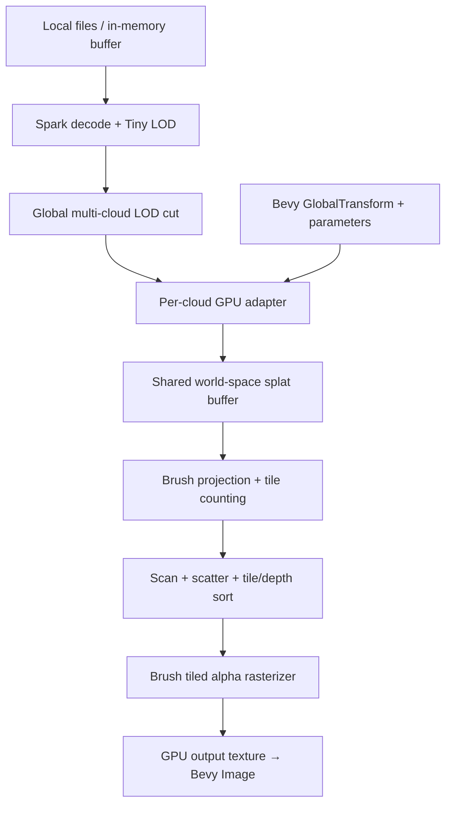

# Native Spark × Brush × Bevy experiment

A separate desktop Rust application. Open local Gaussian PLY files, orbit the camera, and instance multiple clouds as Bevy entities. The TypeScript/WebGPU library and its Rust/WASM workspace are unchanged.

## Run

```sh
cd apps/native
cargo run --release -p gaussian-viewer
# Or open one or several files immediately:
cargo run --release -p gaussian-viewer -- /path/to/model.ply /path/to/second.ply
# Tiny bundled fixture, no downloads:
cargo run --release -p gaussian-viewer -- tests/fixtures/rgb-binary.ply
```

Rust 1.90.0 is pinned in `rust-toolchain.toml`. On macOS, install the Xcode command line tools (`xcode-select --install`); wgpu uses Metal. CUDA is not required. On Ubuntu/Debian install:

```sh
sudo apt-get install build-essential pkg-config libx11-dev libxkbcommon-dev libwayland-dev
```

The Linux file picker uses an XDG desktop portal (usually already provided by GNOME/KDE). CLI paths and file dropping work without a portal. Initial release builds of Bevy take several minutes.

| Control | Action |
| --- | --- |
| O | Native file picker; selecting multiple files adds multiple entities |
| Drop files | Add clouds from disk |
| Left drag | Orbit |
| Right/middle drag | Pan |
| Wheel | Zoom |
| F | Frame all clouds |
| D | Instance the first cloud with a separate translation |
| C | Remove every cloud |
| [ / ] | Halve/double the global selected-splat budget |
| − / + | Coarser/finer pixel LOD threshold |

The HUD shows source/LOD node counts, the global draw count, exact tile intersection count, bytes uploaded this frame, and explicit load/render errors.

## What comes from each upstream

* **Spark**: the existing, pinned `../../rust/vendor/spark-lib` is reused directly, including incremental binary PLY/SPZ/SPLAT/KSPLAT/SOGS/RAD decoding, Gaussian merging and Tiny LOD construction. Standard Gaussian PLY and SuperSplat PLY go through Spark; scalar ASCII PLY is normalized to binary using this project's existing adapter. Native best-first traversal ports the algorithm from Spark's Rust `spark-rs/lod_tree.rs`, with a shared budget across instances, projected feature size and radial/foveated importance. No JavaScript or WASM runtime is involved.
* **Brush v0.3.0**: forward WGSL covariance/Jacobian projection, spherical harmonics, alpha-dependent bounds, StopThePop tile intersection tests and the tile rasterizer are adapted to the native data contract. Original source shaders and the Apache-2.0 license are retained under `third_party/brush`; exact revisions and changes are listed in [UPSTREAM.md](UPSTREAM.md). This deliberately uses Brush's WGSL release rather than its newer CubeCL/Burn training stack.
* **Bevy 0.17.3**: ECS, hierarchy transforms, input, native window and presentation. The renderer uses **Bevy's own wgpu device and queue**. There is no second GPU context or CPU readback/upload of the rendered image.

## Data flow



Each entity owns a GPU source buffer containing its selected local-space records. Unchanged cuts reuse those buffers; camera and entity transforms do not upload the source data again. The adapter dispatch for each entity writes a disjoint span in the shared buffer. It applies `GlobalTransform` to centers and the **full affine basis** to covariance axes, retaining non-uniform scale, reflection and parent-induced shear. It evaluates SH in local view direction, so moving/rotating a cloud preserves its appearance. Spark's merged opacity above one is converted to volume inflation (`opacity^(1/3)`) with a unit peak alpha, before the per-cloud opacity multiplier.

The final sort is global across all clouds, by `(tile, positive depth, splat index)`. Separate final alpha passes per entity would incorrectly compose interpenetrating clouds; only the data preparation is per cloud.

| Buffer row | Contents | Bytes |
| --- | --- | ---: |
| Per-cloud source | center + decoded opacity; linear scales; xyzw quaternion; RGB DC + SH1–SH3 | 240 |
| Shared world | center + opacity; 3 transformed covariance axes; evaluated RGB | 80 |
| Brush projected | screen XY, inverse covariance, RGBA | 36 |
| Intersection pair | tile ID, positive float depth bits, splat index, padding | 16 |

Passes are: per-cloud adaptation → project/count → inclusive parallel scan → exact intersection allocation → scatter → GPU bitonic tile/depth sort → tile range extraction → Brush rasterize. The scan and bitonic sort are native replacements for Brush's Burn-owned scan/radix dispatch. Every dispatch uses bounds checks. The intersection allocation is checked against the device binding limit and `max_intersections`; exceeding a limit reports an error instead of dropping arbitrary splats. An eight-byte count/overflow readback synchronizes projection/allocation, as Brush's renderer does; splats and pixels stay on the GPU.

## Bevy plugin API

```rust,ignore
use bevy::prelude::*;
use bevy_gaussian::{GaussianCamera, GaussianCloud, GaussianPlugin, GaussianTarget};
use bevy_gaussian::spark_lod::GaussianBuffer;
use std::path::Path;

// Add after DefaultPlugins:
app.add_plugins(GaussianPlugin);

// Run decoding/tree construction on a loader thread, then pass the Arc back:
let buffer = GaussianBuffer::load(Path::new("model.ply"), |_| {})?;
commands.spawn((
    GaussianCloud::new(buffer.clone()),
    Transform::from_xyz(1.0, 0.0, 0.0),
));
commands.spawn((
    GaussianCloud::new(buffer),
    Transform::from_scale(Vec3::splat(0.5)),
));
commands.spawn((GaussianCamera::default(), camera_transform));
// Exactly one GaussianCamera and one output target per render plugin.
let target = GaussianTarget::new(&mut images, width, height);
// Display target.image through a Sprite, UI ImageNode, or another GPU consumer.
commands.insert_resource(target);
```

`GaussianBuffer::from_records(&[SourceSplat])` is the in-memory entry point. `GaussianCloud` exposes opacity, splat scale, LOD scale and an enabled flag. Parent transforms and optional inherited visibility are respected. `GaussainCloud` is an alias for the spelling in the experiment brief. `GaussianSettings` controls the global budget, pixel threshold and intersection allocation ceiling; `GaussianTelemetry` exposes counters/errors.

## Validation

```sh
cargo fmt -p spark-lod -p brush-renderer -p bevy-gaussian -p gaussian-viewer -- --check
cargo check --workspace --locked
cargo test --workspace --locked
# GPU acceptance on Metal/Vulkan/DX12, or Mesa lavapipe:
cargo test -p brush-renderer --test gpu --locked -- --ignored --nocapture
# Native window + Bevy plugin + file loader acceptance (Linux, needs xvfb):
GAUSSIAN_SMOKE_TEST=1 xvfb-run -a cargo run -p gaussian-viewer -- tests/fixtures/rgb-binary.ply
```

Do not run `cargo fmt --all`: Cargo also follows the path dependency to Spark, whose upstream formatting is intentionally retained.

Tests cover binary/ASCII decoding and truncation, complete/disjoint budgeted cuts, multi-instance budgets, near/far LOD changes, every WGSL module, Rust/GPU struct layout, and GPU pixel comparisons against an independent CPU oracle. GPU acceptance includes overlapping clouds in reversed order, affine shear/non-uniform scale, quaternion rotation, SH3, merged LOD opacity, odd image sizes, resize, deletion, source buffer reuse and explicit intersection overflow errors.

## Experiment boundaries

This is a resident local-file viewer. File decoding/tree building run off the UI thread; the decoded hierarchy remains in CPU memory, and only the selected cut is resident on the GPU. Spark's browser worker/network paging protocol and HTTP range cache are not ported; standalone files that require external RAD chunks need a future native paging transport. This does not change the browser renderer's backend.

The renderer is forward-only, pinhole, SH degree 0–3 and one Gaussian camera/output target. It displays an independent Gaussian image; opaque Bevy meshes do not yet participate in its depth/compositing. GPU bitonic sorting and the eight-byte count synchronization prioritize a small, reviewable integration over Brush's current radix/CubeCL performance. It is not a benchmark-equivalent replacement for current Brush or Spark. Device-limit errors retain the previous image and appear in the HUD; lower the budget or increase the pixel threshold to recover.
